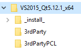
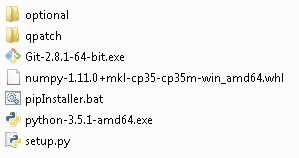
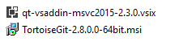
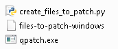

.. include:: ../include/global.inc

.. _install-all-in-one-dev-setup_creation:

Creating the All-In-One development setup
*****************************************

This chapter describes how the all-in-one development setup is created. The
setup bundles all components that are needed to compile and develop |itom|.
How the finished setup is installed is described in
:ref:`install_all-in-one_development_setup <install-all-in-one-dev-setup>`.

The creation consists of the following steps, which must be executed in this order:

1. :ref:`Download all software and packages <aio-creation-download>`
2. :ref:`Create the folder structure <aio-creation-folders>`
3. :ref:`Fill the _install_ folder <aio-creation-install-folder>`
4. :ref:`Fill the 3rdParty folder <aio-creation-3rdparty>`
5. :ref:`Fill the 3rdPartyPCL folder <aio-creation-3rdpartypcl>` (optional)
6. :ref:`Adapt the setup script <aio-creation-setup-script>`
7. :ref:`Pack the setup <aio-creation-pack>`

All steps are shown for a 64-bit version. A 32-bit version is created in the
same way with the corresponding 32-bit software and packages.

.. _aio-creation-download:

Step 1: Download software and packages
======================================

Required software
-----------------

Download the current versions of the following software:

* `MS Visual Studio Community Edition <http://www.visualstudio.com/de-de/downloads/download-visual-studio-vs.aspx>`_
* `Qt Visual Studio Add-in <https://download.qt.io/development_releases/vsaddin/>`_
* `Qt for Windows x64 Online Installer <https://www.qt.io/download-qt-installer?hsCtaTracking=99d9dd4f-5681-48d2-b096-470725510d34%7C074ddad0-fdef-4e53-8aa8-5e8a876d6ab4>`_
* `CMake <http://cmake.org/download/>`_
* `Python Windows x64 executable installer <http://www.python.org/downloads/windows/>`_
* `Git x64 <https://git-scm.com/downloads>`_
* `TortoiseGit <http://tortoisegit.org/download/>`_
* `Doxygen <https://sourceforge.net/projects/doxygen/files/rel-1.8.11/>`_
* `OpenCV source <https://opencv.org/releases.html>`_

Install Visual Studio Community Edition without optional features. All other
software is needed later in the folders described below.

Packages for the 3rdPartyPCL folder (optional)
----------------------------------------------

These packages are only required if the setup should contain the point cloud
library (PCL). They are not necessary for a working |itom|.

* `Boost binaries <https://www.boost.org/>`_
* `Eigen repository <https://eigen.tuxfamily.org/index.php?title=Main_Page>`_
* `VTK source <http://www.vtk.org/download/>`_
* `PCL source <http://github.com/PointCloudLibrary/pcl/>`_
* `FLANN repository <https://github.com/mariusmuja/flann/>`_
* `QHull repository <http://www.qhull.org/download/>`_

FLANN and QHull can also be copied from the current all-in-one development version.

.. _aio-creation-folders:

Step 2: Create the folder structure
===================================

Create a folder on your hard drive with a long path name. This folder is called
**${MAINDIR}** in the following (*only for Qt5*). Later, the all-in-one path on
the destination computer must be shorter than this path, due to the Qt
patching. For example:

``E:\itom_all-in-one_development\itom_all-in-one_development\vs2017_qt5.12.1_x64\``

Then create the following folders relative to **${MAINDIR}**:

* **_install_**: files that execute the installation procedure (step 3)
* **3rdParty**: Python, Qt and OpenCV (step 4)
* **3rdPartyPCL**: Boost, Eigen, FLANN, QHull, VTK and PCL (step 5, optional)

.. _aio-creation-install-folder:

Step 3: Fill the _install_ folder
=================================

The _install_ folder is used to execute the installation procedure of the
all-in-one development. Copy the following files into **${MAINDIR}/_install_**:

_install_/optional
------------------

This folder is for optional software that is not necessary to build and compile
a working |itom|, but is useful for development. Copy the following files into
**${MAINDIR}/_install_/optional**:

_install_/qpatch
----------------

The folder *qpatch* contains the files that are needed to patch the prebuilt
Qt version. Copy the following files into **${MAINDIR}/_install_/qpatch**:

Then change the **root** Qt path and the target path in
**create_files_to_patch.py**. Execute the script and check that the file names
in **files-to-patch-windows** have been found.

.. _aio-creation-3rdparty:

Step 4: Fill the 3rdParty folder
================================

3rdParty/Python
---------------

For the compilation of |itom| it is not necessary to have Python installed on
the computer. To create the Python folder:

1. Install the current version of **Python** on your computer.
2. Copy the installed **Python** folder into **${MAINDIR}/3rdParty/Python**.
3. Uninstall Python again.
4. Install numpy into the copied folder using pip:

   .. code-block:: bash

       python.exe -m pip install numpy

.. warning::

    You have to copy the installed folder. Renaming it and uninstalling
    afterwards does not work!

3rdParty/Qtx.xx.x
-----------------

Copy the output of the Qt compilation process into this folder, see
:ref:`build_dependencies_qt`.

3rdParty/OpenCVx.x.x
--------------------

Copy the output of the OpenCV compilation process into this folder, see
:ref:`build_dependencies_opencv`.

.. _aio-creation-3rdpartypcl:

Step 5: Fill the 3rdPartyPCL folder (optional)
==============================================

Boost, Eigen, FLANN and QHull can be used as downloaded binaries. VTK and PCL
must be compiled on your computer. Put the version number into the folder
names, e.g. **boost1.69.0-64** or **Eigen3.3.7**.

3rdPartyPCL/boostX.XX.X
-----------------------

Execute the downloaded prebuilt binary installer (e.g.
**boost_1_69_0-msvc-12.0-64.exe**) and install Boost in a folder with a short
path that is different from the Qt folder. Then copy the folders **boost** and
**lib** into **${MAINDIR}/3rdPartyPCL/boostX.XX.X-64**.

3rdPartyPCL/EigenX.X.X
----------------------

Unzip the folders **Eigen** and **unsupported** from the Eigen zip file into
**${MAINDIR}/3rdPartyPCL/EigenX.X.X/**. For further information see
http://eigen.tuxfamily.org/index.php?title=Main_Page.

3rdPartyPCL/flannX.X.X
----------------------

Copy the downloaded FLANN version into **${MAINDIR}/3rdPartyPCL/flannX.X.X**.
For further information see https://github.com/mariusmuja/flann or
:ref:`build_dependencies_flann_qhull`.

3rdPartyPCL/qhullXXXX.X
-----------------------

Copy the downloaded QHull version into **${MAINDIR}/3rdPartyPCL/qhullXXXX.X**.
For further information see http://www.qhull.org/download/ or
:ref:`build_dependencies_flann_qhull`.

3rdPartyPCL/VTKx.x.x
--------------------

Copy the output of the VTK compilation process into this folder, see
:ref:`build_dependencies_vtk`.

3rdPartyPCL/PCLx.x.x
--------------------

Copy the output of the PCL compilation process into this folder, see
:ref:`build_dependencies_pcl`.

.. _aio-creation-setup-script:

Step 6: Adapt the setup script
==============================

Update the versions of the Python packages (pip, setuptools, wheel) in
**setup_itom_all-in-one.bat**.

The **setup.py** file checks whether all packages are available in the right
version, so it must be adapted to the new versions of the software and
packages. Set the following variables at the beginning of the file:

* **qtOriginalBuildPath**, e.g. ``C:\itom_all-in-one_development\itom_all-in-one_development\itom_all-in-one_development\VS2017_Qt5.12.1_x64\3rdParty\Qt5.12.1\5.12.1\msvc2017_64``
* **qtNewBuildPath**, e.g. ``../3rdParty/Qt5.12.1/5.12/msvc2017_64``
* **numpyRequiredVersion**: the numpy version attached to the setup, e.g. ``1.11.0``
* **pythonRequiredVersion**: the Python version attached to the setup, e.g. ``3.5.``

Then check the following functions:

* **generateCMakeDict**: the version of Visual Studio and the paths of
  **CMake, OpenCV, Python library version, VTK, PCL, Eigen, Flann, QHull**.

  .. figure:: images/all-in-one-create/Setup_packages_versions.PNG
     :width: 100%
     :align: center

* **installNumpy**: the file names of the numpy whl files.

  .. figure:: images/all-in-one-create/Setup_numpy_file.PNG
     :width: 631px
     :align: center

* **upgradePip**, **installPyflakes**, **installJedi**: the file names of the whl files.

.. _aio-creation-pack:

Step 7: Pack the setup
======================

Use 7zip and the rar format to pack the compiled Windows binaries together and
upload them to sourceforge.
